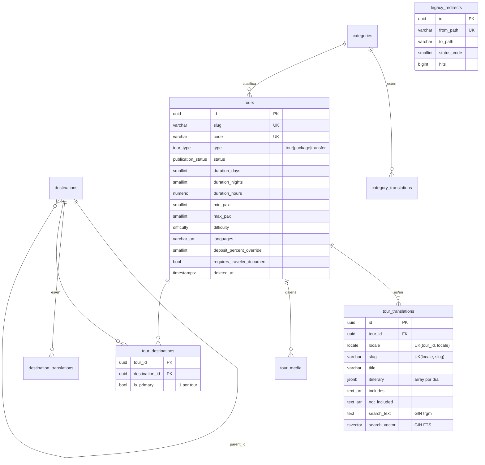
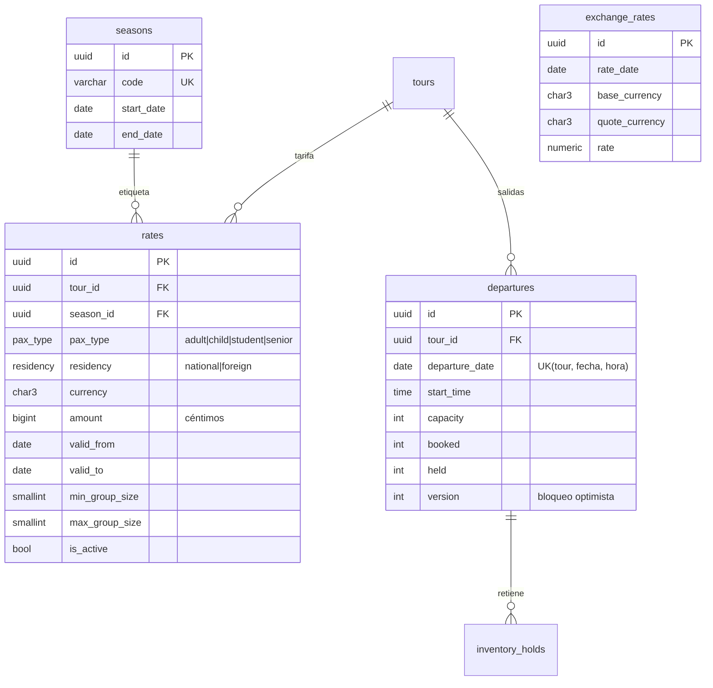
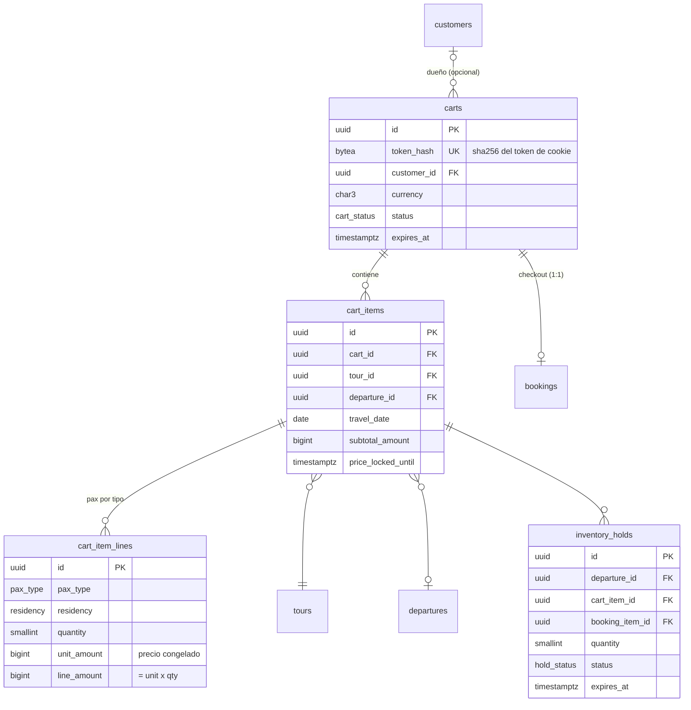
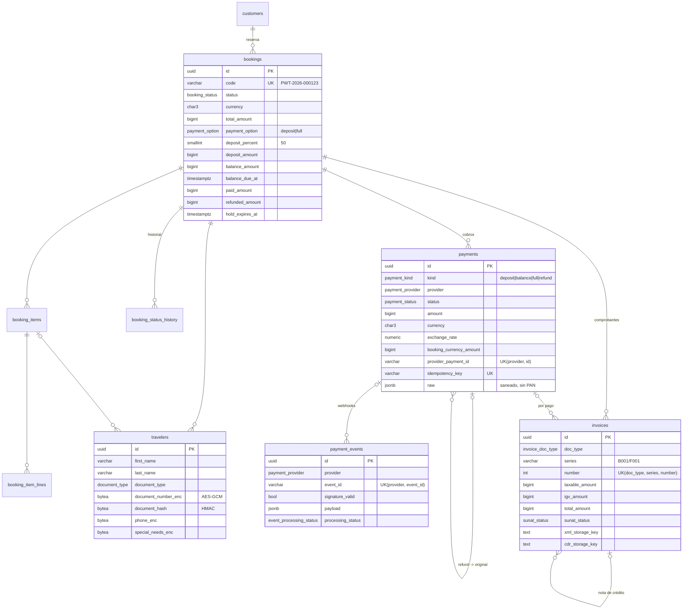
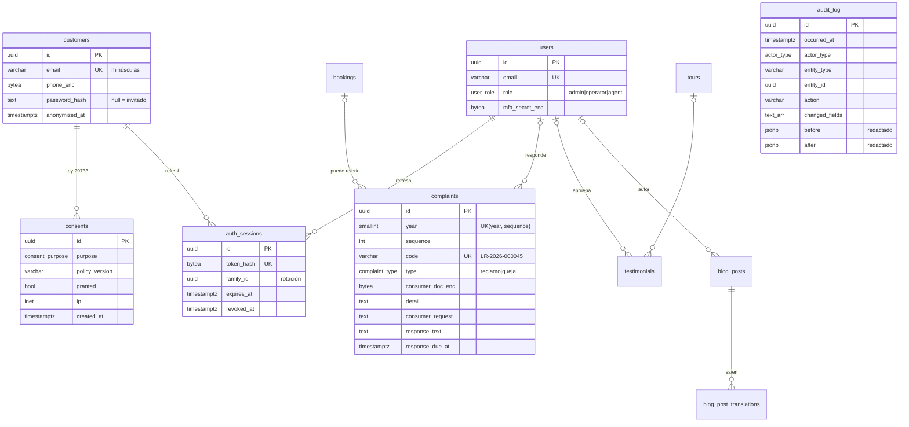
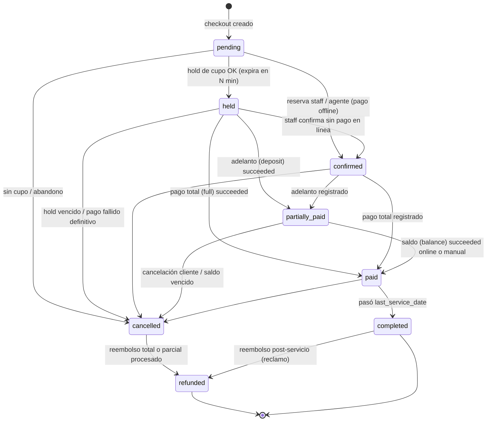

# Modelo de datos MVP — Peru Wonders Tours

Fuente de verdad del esquema para [[entities/proyecto-turismo-peru]]. Stack según
[[decisions/ADR-0001-stack-tecnologico]]; reglas de negocio del adelanto en
[[concepts/alcance-cliente-v1]].

| Artefacto | Ruta |
|---|---|
| Schema Prisma (36 modelos, 30 enums) | `apps/api/prisma/schema.prisma` |
| Config Prisma 7 (URL de conexión) | `apps/api/prisma.config.ts` |
| Migración 0: extensiones, `immutable_unaccent`, FTS `es_unaccent`, `uuid_generate_v7()` | `apps/api/prisma/sql/00_extensions.sql` (+ `.down.sql`) |
| CHECK, EXCLUDE, triggers, auditoría, correlativos | `apps/api/prisma/sql/constraints.sql` (+ `.down.sql`) |

## 1. Decisiones clave

1. **Prisma 7.x** (estable actual 7.10; la 8 está en RC). En Prisma 7 la URL ya no va en
   `datasource` sino en `prisma.config.ts` → `env("DATABASE_URL")`. El generador es
   `prisma-client` con `output` obligatorio (`src/generated/prisma`) y el cliente exige
   driver adapter (`@prisma/adapter-pg`). Encaja con `apps/api` (`"type": "module"`).
2. **PK `uuid(7)`** generada por Prisma (ordenable por tiempo → inserciones al final del
   B-tree, menos fragmentación que v4). Los triggers usan `uuid_generate_v7()` propia
   (PG16 no trae `uuidv7()`; llega en PG18).
3. **Dinero en `BigInt` (céntimos) + `currency char(3)`**, siempre `PEN`/`USD`
   (`is_supported_currency`). En JS es `bigint`: serializar a string o number en el borde
   de la API (los montos caben de sobra en `Number.MAX_SAFE_INTEGER`).
   El tipo de cambio se congela por pago (`payments.exchange_rate`,
   `booking_currency_amount`) y por comprobante; `exchange_rates` guarda el de referencia diario.
4. **Plan de pago dentro de `bookings`** (no tabla aparte): `total_amount`,
   `payment_option` (deposit/full), `deposit_percent` (50 por defecto; `tours.deposit_percent_override`
   para Machu Picchu/tren), `deposit_amount`, `balance_amount`, `balance_due_at`,
   `paid_amount`, `refunded_amount`. CHECK `deposit_amount + balance_amount = total_amount`.
   Con un solo plan por reserva, una tabla `payment_plans` 1:1 solo añadiría joins.
5. **Inventario por salida (`departures`)** con `capacity`, `booked`, `held` y `version`
   (bloqueo optimista). CHECK `booked + held <= capacity` como red de seguridad final:
   aunque la app falle, la base no permite sobreventa.
6. **Holds en base de datos** (`inventory_holds`) como fuente de verdad; Redis solo acelera.
7. **Correlativos sin huecos** (`document_sequences` + `next_document_number()`): libro de
   reclamaciones por año, series SUNAT, códigos `PWT-AAAA-NNNNNN`.
8. **Auditoría por triggers** sobre `bookings`, `booking_items`, `payments`, `customers`,
   `travelers`, `complaints`, `invoices`, `users`, `rates`; `audit_log` es append-only
   (UPDATE/DELETE/TRUNCATE bloqueados). La app fija el actor por transacción con
   `SET LOCAL app.actor_type / app.actor_id / app.request_id / app.client_ip`.
   El historial de estados de la reserva lo escribe un trigger que además **valida la transición**.
9. **Ley 29733**: PII solo en `customers`, `travelers`, `complaints` e `invoices` (receptor).
   Documento, teléfono, necesidades especiales (dato sensible de salud) y secreto MFA van
   **cifrados en la aplicación** (AES-256-GCM, clave en KMS/variable segura) como `bytea`;
   `*_hash` = HMAC-SHA256 (blind index) para buscar o deduplicar sin descifrar.
   El log de auditoría excluye columnas cifradas y PII directa (solo registra qué cambió).
   Consentimientos con histórico append-only (finalidad, versión de política, IP, fecha).
10. **Conservación legal**: `bookings`, `payments`, `invoices`, `complaints` sin DELETE
    físico (trigger). Clientes/viajeros se **anonimizan** (`anonymized_at`), no se borran,
    mientras haya obligaciones tributarias.
11. **Búsqueda**: `pg_trgm` sobre `search_text` (`lower(unaccent(título + resumen))`, índice
    GIN declarado en Prisma) para tolerar typos; full-text `search_vector` con configuraciones
    `es_unaccent`/`en_unaccent` y pesos A–D (índice GIN en SQL). Ambas columnas las mantiene un trigger.
12. **Índices parciales** con el preview `partialIndexes` de Prisma (para que `migrate` no
    los trate como drift): portada única por tour, destino principal único, carrito activo
    único por cliente, un solo adelanto/pago total exitoso por reserva, colas de jobs
    (holds vencidos, saldos por vencer, outbox, webhooks fallidos, comprobantes pendientes).
13. **Outbox transaccional** (`outbox_events`) para emails, emisión SUNAT y notificaciones
    vía BullMQ sin perder eventos si Redis cae.

## 2. ERD por dominio

### 2.1 Catálogo



### 2.2 Precios e inventario



`rates_no_overlap_ex` (EXCLUDE GiST + `btree_gist`) impide dos tarifas activas que se
solapen en fechas **y** tamaño de grupo para el mismo tour × pasajero × residencia ×
moneda × temporada.

### 2.3 Carrito



### 2.4 Reservas, pagos y comprobantes



### 2.5 Clientes, staff, auth, legal y contenido



`document_sequences (scope, year, series) → last_value` y `outbox_events` completan el modelo.

## 3. Máquina de estados: reserva con adelanto 50 % y saldo



La función `booking_status_transition_allowed()` codifica exactamente esta tabla; el
trigger `bookings_status_guard_trg` rechaza cualquier otra transición y escribe
`booking_status_history`. Los CHECK de `bookings` amarran estado y montos:
`partially_paid ⇒ deposit ≤ paid < total`, `paid ⇒ paid = total`, `held ⇒ hold_expires_at`,
`cancelled/refunded ⇒ cancelled_at`.

### Flujo del adelanto (transacción por paso)

1. **Checkout** (`pending → held`): por cada ítem con inventario,
   `UPDATE departures SET held = held + n, version = version + 1 WHERE id = $1 AND version = $2 AND booked + held + n <= capacity`
   (0 filas ⇒ releer y reintentar o "sin cupo") + `INSERT inventory_holds`. Se calcula
   `deposit_amount = round(total × deposit_percent / 100)` (redondeo a favor del cliente en
   el adelanto, decisión pendiente de negocio) y `balance_amount = total − deposit`.
   `balance_due_at` = primer servicio − 7 días (configurable). Si el viaje es antes de esa
   fecha, se fuerza `payment_option = full`.
2. **Pago del adelanto**: `payments(kind=deposit, idempotency_key)`; el webhook entra a
   `payment_events` (UK `provider + event_id` ⇒ idempotente). En **una transacción**:
   payment `succeeded` → `bookings.paid_amount += booking_currency_amount` → estado
   `partially_paid` → holds `converted` y `departures.held -= n, booked += n` → outbox
   (`booking.deposit_paid` ⇒ email + boleta/factura por el monto pagado).
3. **Saldo**: enlace de pago (`kind=balance`) o registro manual en backoffice
   (`provider=manual`, `cash`/`bank_transfer`, `recorded_by_user_id` obligatorio).
   Al completar ⇒ `paid` + segundo comprobante.
4. **Vencimiento del saldo**: job sobre el índice parcial `bookings(balance_due_at) WHERE status='partially_paid'`
   ⇒ recordatorios; la política de cancelación (pendiente del cliente) decide si se cancela.
5. **Cancelación/reembolso**: `cancelled` libera cupo (`booked -= n`); el reembolso es otro
   `payment(kind=refund, parent_payment_id)` + nota de crédito; al procesarse ⇒ `refunded`.

## 4. Postgres local sin admin, sin Docker, sin WSL (Windows)

Evaluación (no se instaló nada):

| Opción | Admin | PG 16 | Extensiones `pg_trgm`/`unaccent`/`btree_gist` | Veredicto |
|---|---|---|---|---|
| **Binarios ZIP de EDB** (portable) | No | Sí (16.x) | Sí, contrib completo | **Recomendada** |
| `scoop install postgresql16` (Scoop, perfil de usuario) | No | Sí | Sí (usa los binarios EDB) | Equivalente, si se usa Scoop |
| npm `embedded-postgres` (binarios de zonky) | No | Sí (`16.x.y-beta.N`) | **No documentado** (binarios "ligeros") | Alternativa scriptable; verificar extensiones antes de adoptar |
| PGlite (WASM) | No | Compatible con 16/17, mono-conexión | Parcial | Solo pruebas unitarias; no para Prisma migrate + triggers |
| Instalador EDB (.exe) | **Sí** (servicio Windows) | Sí | Sí | Descartado |

**Recomendación:** binarios ZIP portables de PostgreSQL 16 (EDB), en la carpeta del usuario,
controlados con scripts `pg_ctl`. Son el servidor real (mismo comportamiento que producción),
traen todo `contrib` y no requieren servicio de Windows ni privilegios.
`embedded-postgres` queda como opción B para automatizar en CI/tests, **solo si** tras instalarlo
`SELECT name FROM pg_available_extensions WHERE name IN ('pg_trgm','unaccent','btree_gist');`
devuelve las 3 filas.

### Pasos (opción recomendada, PowerShell sin admin)

```powershell
# 1. Descargar "PostgreSQL 16.x Windows x86-64 binaries (zip)" desde
#    https://www.enterprisedb.com/download-postgresql-binaries  y extraer en:
#    $env:USERPROFILE\pgsql16   (quedan bin\, lib\, share\)
$PG = "$env:USERPROFILE\pgsql16"
$env:PATH = "$PG\bin;$env:PATH"

# 2. Crear el clúster (UTF-8, locale neutro para ordenar igual que en Linux)
initdb -D "$PG\data" -U postgres -A scram-sha-256 -E UTF8 --locale=C --pwprompt

# 3. Arrancar en un puerto propio (evita choques) y con log
pg_ctl -D "$PG\data" -o "-p 5433" -l "$PG\pg.log" start

# 4. Crear rol y base de la app (rol sin superusuario)
psql -p 5433 -U postgres -c "CREATE ROLE pwt LOGIN PASSWORD '<elige-una-clave-local>' CREATEDB;"
psql -p 5433 -U postgres -c "CREATE DATABASE pwt_dev OWNER pwt;"
# Las extensiones requieren superusuario o ser 'trusted' (pg_trgm, unaccent y btree_gist lo son en PG13+).

# 5. apps/api/.env (no versionado)
#    DATABASE_URL="postgresql://pwt:<clave>@localhost:5433/pwt_dev?schema=public"

# Parar:   pg_ctl -D "$PG\data" stop
```

### Opción B: `embedded-postgres` (cuando termine la instalación en curso)

```powershell
pnpm --filter @pwt/api add -D embedded-postgres@16   # trae @embedded-postgres/windows-x64
```

Script `apps/api/scripts/dev-db.ts`: `new EmbeddedPostgres({ databaseDir: './.pgdata', port: 5433, user: 'postgres', password: '...', persistent: true })`
→ `initialise()` (solo la primera vez) → `start()` → `createDatabase('pwt_dev')`; `stop()` al salir.
Añadir `.pgdata/` a `.gitignore`.

### Aplicar el esquema (cualquiera de las dos opciones)

```powershell
pnpm --filter @pwt/api add -D prisma@7 ; pnpm --filter @pwt/api add @prisma/client@7 @prisma/adapter-pg pg dotenv
cd apps/api
pnpm prisma migrate dev --create-only --name extensions      # pegar sql/00_extensions.sql en el migration.sql vacío
pnpm prisma migrate dev --create-only --name init            # generado por Prisma: REVISAR
pnpm prisma migrate dev --create-only --name db_constraints  # pegar sql/constraints.sql
pnpm prisma migrate dev                                       # aplica las 3
pnpm prisma generate
```

> Orden importante: `extensions` debe quedar **antes** de `init` (el índice GIN `gin_trgm_ops`
> lo necesita). Si Prisma genera `init` primero, renombrar la carpeta de `extensions` con un
> timestamp anterior antes de aplicar.

## 5. Índices: justificación y validación

Cada índice del schema lleva un comentario con la consulta que sirve (listado público,
cotizador, calendario, "mis reservas", bandeja de backoffice, jobs). Son **hipótesis de
diseño**: al tener datos semilla realistas (≈ 300 tours × 365 salidas × 2 idiomas) se
validarán con `EXPLAIN (ANALYZE, BUFFERS)` y se eliminarán los que no se usen
(`pg_stat_user_indexes.idx_scan = 0` tras pruebas de carga).

Consultas de referencia a validar:

```sql
-- Búsqueda tolerante (autocompletar): "machu pichu" -> Machu Picchu
SELECT tour_id, similarity(search_text, lower(immutable_unaccent($1))) AS s
  FROM tour_translations
 WHERE locale = 'es' AND search_text % lower(immutable_unaccent($1))
 ORDER BY s DESC LIMIT 10;

-- Full-text con ranking
SELECT tour_id, ts_rank(search_vector, q) AS r
  FROM tour_translations, websearch_to_tsquery('es_unaccent', $1) q
 WHERE locale = 'es' AND search_vector @@ q
 ORDER BY r DESC LIMIT 20;

-- Calendario de disponibilidad
SELECT departure_date, start_time, capacity - booked - held AS available
  FROM departures
 WHERE tour_id = $1 AND departure_date BETWEEN $2 AND $3 AND NOT is_closed;
```

## 6. Riesgos y pendientes

- **Prisma 7 vs. instrucción original**: se pidió `url = env("DATABASE_URL")` en el
  `datasource`; en Prisma 7 eso está deprecado/rechazado, así que la URL vive en
  `prisma.config.ts`. Si el equipo fija Prisma 6, basta con mover la línea al schema y usar
  `provider = "prisma-client-js"`, pero entonces se pierde `partialIndexes` (verificar).
- **`partialIndexes` es preview**: si cambia la sintaxis, mover esos índices a SQL y
  aceptar revisión manual de drift en cada `migrate dev --create-only`.
- **Drift del GIN sobre `search_vector`** (columna `Unsupported("tsvector")`): Prisma puede
  proponer `DROP INDEX tour_translations_search_vector_idx`; **siempre** generar con
  `--create-only` y revisar. Igual con cualquier objeto solo-SQL.
- **`BigInt` en JSON**: `JSON.stringify` falla con `bigint`; definir un interceptor o
  serializador global en NestJS.
- **Redondeo del adelanto** (céntimo impar) y **regla de 7 días** del saldo: pendientes del
  cliente; la base solo garantiza `deposit + balance = total`.
- **Política de cancelación/reembolso**: no modelada como tabla todavía (solo
  `cancellation_policy_code`/`cancellation_policy_version`). Cuando el cliente la defina,
  crear `cancellation_policies` con tramos (días antes → % reembolsable).
- **Plazo de respuesta del libro de reclamaciones**: `response_due_at` lo calcula la app
  (días hábiles según la norma vigente; validar con `compliance-peru-analyst`). Retención
  mínima legal de reclamaciones y comprobantes: definir job de archivado, nunca DELETE.
- **IGV en turismo** (exportación de servicios a no domiciliados vs. nacionales): los campos
  `taxable/exempt/igv` lo soportan; la regla la define `payments-integration-senior` con el contador.
- **Gestión de claves de cifrado**: rotación (prefijo de versión de clave dentro del
  `bytea`) y custodia fuera de la base; sin esto el cifrado de columnas no protege.
- **Triggers de auditoría** añaden escritura por cada cambio: medir en pruebas de carga;
  `departures` se excluyó a propósito (cambia en cada hold; su trazabilidad está en `inventory_holds`).
- **`embedded-postgres`**: no se pudo confirmar que incluya `contrib`; no adoptarlo sin la
  verificación de la sección 4.
- Particionado de `audit_log` por mes cuando supere ~10 M filas (no necesario en MVP).
